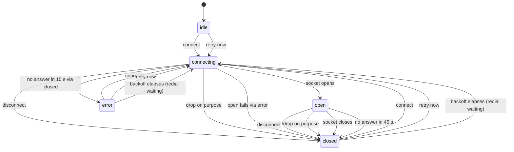

# Engine connection state

Drawn from `src/renderer/src/shared/engine/host.ts` and `src/renderer/src/shared/engine/json-rpc-gateway.ts` by `tests/unit/stateCharts.test.ts`, which fails when this file is stale. Do not edit it by hand; regenerate it with `UPDATE_STATE_CHARTS=1 npx vitest run tests/unit/stateCharts.test.ts`.

An edge is labelled with its event, then in brackets the cases that take it when not every case of its state does. `via` names a state the code passes through on the way.

Redial n waits a random time below its ceiling: 300 ms, 600 ms, 1.2 s, 2.4 s, 4.8 s, 9.6 s for n = 0 to 5, and 15 s from n = 6 on. A socket that stayed open 5 s sets n back to 0; any other drop or failed dial adds one, so the first redial after a failed dial is n = 1.
