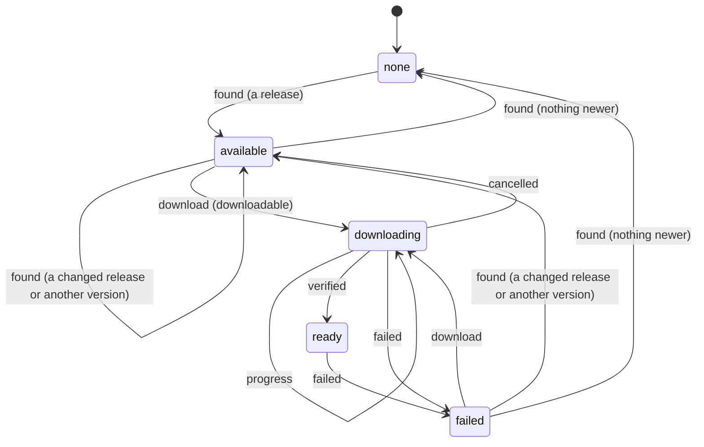

# Update state

Drawn from `src/main/infrastructure/updater/updateState.ts` by `tests/unit/stateCharts.test.ts`, which fails when this file is stale. Do not edit it by hand; regenerate it with `UPDATE_STATE_CHARTS=1 npx vitest run tests/unit/stateCharts.test.ts`.

An edge is labelled with its event, then in brackets the cases that take it when not every case of its state does. `via` names a state the code passes through on the way.

